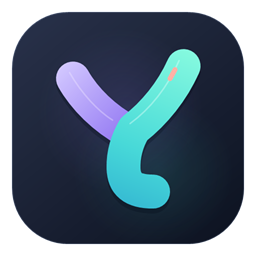
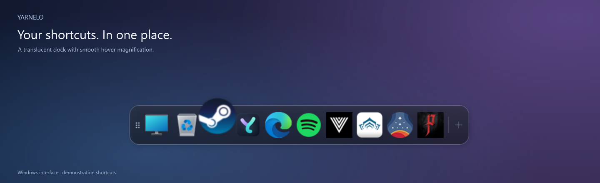
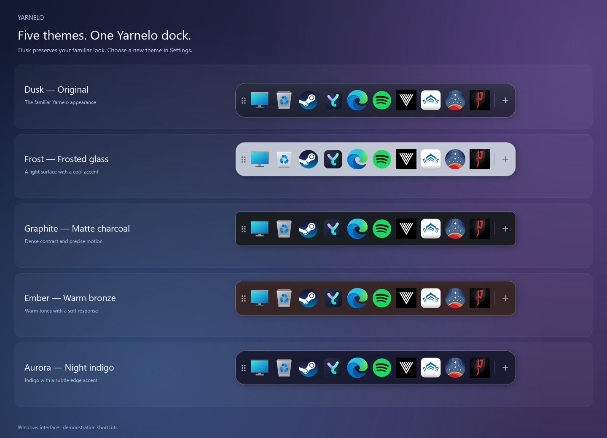
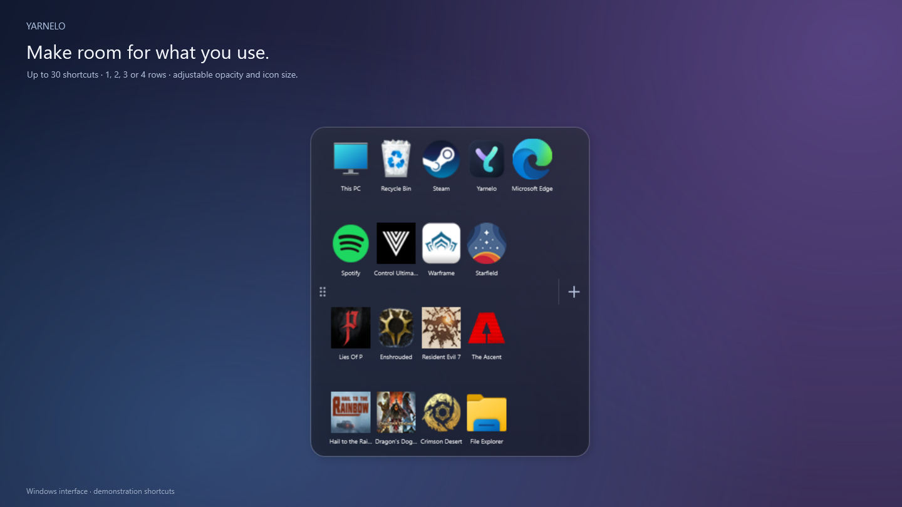
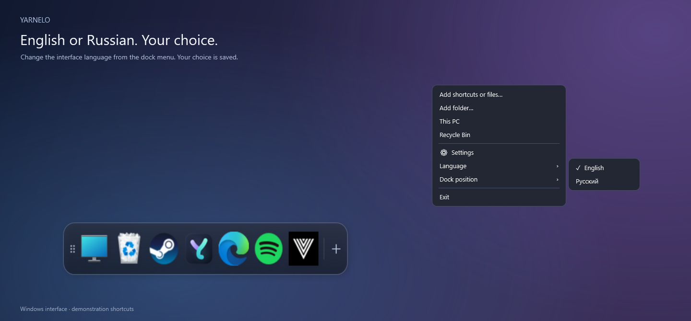
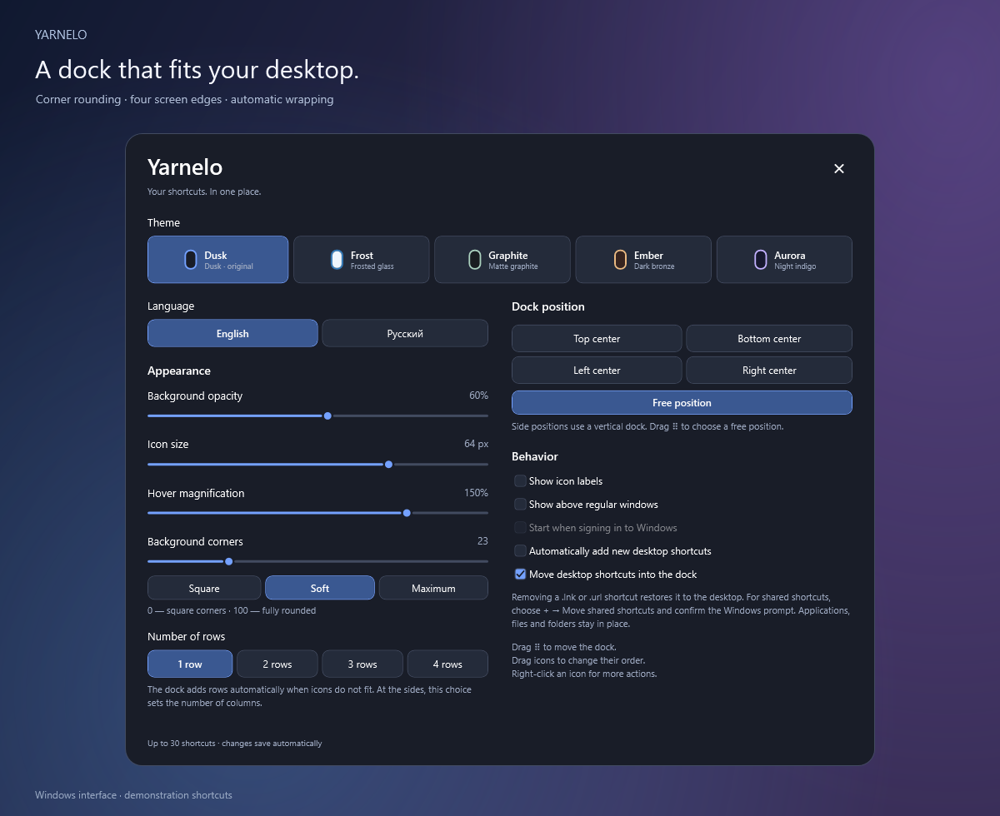

<p align="center">
  
</p>

<h1 align="center">Yarnelo</h1>

<p align="center">Your shortcuts. In one place.</p>
<p align="center"><strong>English</strong> · <a href="README.ru.md">Русский</a></p>

Yarnelo is a translucent shortcut dock for **Windows 10/11 and Linux**, inspired by the shape of the macOS Dock. Keep your favorite apps, games, folders and files together, choose one to four rows, and make room on your desktop.

**[Download the latest release](https://github.com/feogrim-cloud/Yarnelo/releases/latest)** · [Installation](docs/INSTALL.md) · [Report an issue](https://github.com/feogrim-cloud/Yarnelo/issues)

## Screenshots

Windows interface demonstrations rendered by Yarnelo with example shortcuts on a neutral backdrop. The pictured apps and games are examples, not bundled software; their icons belong to their respective owners. [Screenshot details and credits](assets/screenshots/README.md).





| More room for shortcuts | English and Russian interface |
| --- | --- |
|  |  |



## Features

- Up to **30 shortcuts**, with one to four preferred rows and automatic wrapping when the screen fills up.
- Adjustable background opacity and corner rounding, from square corners to a capsule; icon size and hover magnification.
- Five themes for the dock, menus and settings: **Dusk**, **Frost**, **Graphite**, **Ember** and **Aurora**. Each remembers its own opacity and corner rounding; Dusk keeps your original dock colors, motion and background settings. All five share modern settings controls.
- Optional compact one-line captions: **Show icon labels** on Windows or **Show labels** on Linux. Hovering an icon shows its name.
- Center the dock at the top, bottom, left or right. Side docks run vertically with upright icons; dragging the handle enables free positioning.
- Wider, two-column settings with every control on one page and no vertical scrolling.
- Smooth hover, click and rearrangement animations; neighboring icons move aside during a drag.
- Add apps, files, folders, Computer and the Recycle Bin / Trash.
- Optional startup at sign-in on Windows and Linux, controlled in Settings.
- Optional **Automatically add new desktop shortcuts**, off by default. Only new `.lnk` / `.url` on Windows or `.desktop` on Linux are considered while Yarnelo is running; existing icons, ordinary files and folders are not imported automatically.
- **English and Russian interface:** right-click the dock → **Language / Язык** → **English / Русский**. The choice is saved and applies without restarting. The first launch follows your system language: Russian for a Russian locale, English otherwise.
- Local settings and shortcut storage; the app does not send your data to a server.

On **Windows**, desktop `.lnk` and `.url` shortcuts can be moved into the dock and restored from each icon's menu. The dock supports a notification-area menu, optional startup at sign-in, automatic hiding when its space is covered, and fullscreen detection on its own monitor. It returns without taking focus. Optional “above ordinary windows” mode still yields to fullscreen and borderless apps on the dock's monitor. Startup uses a current-user Task Scheduler task with a 10-second logon delay and ordinary account permissions; manage it through the app's startup switch. [Startup details](docs/WINDOWS.md#startup-at-sign-in).

The **Linux preview** supports `.desktop` launchers, files, folders, Computer and Trash. It keeps references to original files and does **not** move them off the desktop. **Settings → Start when signing in → OK** enables current-user XDG autostart, off by default; keep portable copies in a permanent location. [Startup details](docs/LINUX.md#startup-at-sign-in). **X11 is recommended**; ready-made packages use XWayland in Wayland sessions. Window placement and stacking depend on the compositor, and the Linux preview does not yet reproduce Windows fullscreen and overlap detection. [Linux details](docs/LINUX.md).

## Download

Choose a ready-made package from [Releases](https://github.com/feogrim-cloud/Yarnelo/releases/latest). No development tools are needed.

| System | Installer / package | Portable option |
| --- | --- | --- |
| Windows 10/11, Intel/AMD x64 | `Yarnelo-Windows-x64-Setup.exe` | `Yarnelo-Windows-x64-Portable.zip` |
| Windows 10, 32-bit | `Yarnelo-Windows-x86-Setup.exe` | `Yarnelo-Windows-x86-Portable.zip` |
| Windows 11, ARM64 (for example Snapdragon) | `Yarnelo-Windows-arm64-Setup.exe` | `Yarnelo-Windows-arm64-Portable.zip` |
| Ubuntu 22.04+, Debian 12+, Mint 21+, x86_64 | `Yarnelo-Linux-amd64.deb` | `Yarnelo-Linux-x86_64.AppImage` |
| Fedora, x86_64 | `Yarnelo-Linux-x86_64.rpm` | `Yarnelo-Linux-x86_64.AppImage` |
| Other Linux distributions with glibc 2.35+, x86_64 | — | `Yarnelo-Linux-x86_64.tar.gz` |
| Ubuntu 24.04+, Debian 13+, ARM64 | `Yarnelo-Linux-arm64.deb` | `Yarnelo-Linux-aarch64.AppImage` |
| Fedora / other Linux with glibc 2.39+, ARM64 | `Yarnelo-Linux-aarch64.rpm` | `Yarnelo-Linux-aarch64.AppImage` or `Yarnelo-Linux-aarch64.tar.gz` |

**[Installation and checksums](docs/INSTALL.md)** · [Windows guide](docs/WINDOWS.md) · [Linux guide](docs/LINUX.md)

Windows x64/x86 requires **.NET Framework 4.8 or 4.8.1**; native Windows ARM64 requires **Windows 11 and .NET Framework 4.8.1**. Windows 10 ARM64 is not supported by the native ARM64 package. The EXE files are currently unsigned. Linux packages include Python and Qt, but require the system libraries listed in the installation guide: **glibc 2.35+ for x86_64**, **glibc 2.39+ for ARM64**. ARM64 packages do not support Debian 12 or Ubuntu 22.04. Windows 7/8.1, 32-bit Linux and Alpine/musl are outside this release's compatibility scope. The Linux version is a preview, not a claim of testing every distribution or desktop environment. [Choose your architecture](docs/INSTALL.md#choose-a-download).

## Getting started

1. Install the appropriate Windows `Setup.exe`, or extract the complete portable ZIP to a permanent writable folder and run `Yarnelo.exe`. On Linux, install a DEB/RPM or make the AppImage executable; see [installation](docs/INSTALL.md).
2. Drop shortcuts on the dock or use **+** to add them. Drag an icon within the dock to change its position.
3. Right-click the dock for **Settings**, **Language** and **Exit**. Drag its handle to reposition it freely.
4. In **Settings**, choose an edge, preferred rows, background opacity and corner rounding, icon size and magnification. The dock adds rows (columns at the sides) when needed to keep shortcuts on screen.

Choose **Settings → Theme** for the original dark **Dusk**, light ice **Frost**, matte charcoal **Graphite**, warm bronze **Ember** or indigo **Aurora**. Windows applies and saves the choice immediately; Linux applies it with **OK**, while **Cancel** keeps the saved settings. Returning to a theme restores its own opacity and rounding. Icon size, magnification, rows, position, compact labels, startup and automatic desktop-shortcut preferences remain yours. Themes also tune hover, click and drag motion; Aurora's edge accent appears during interaction, with no idle flare.

Enable **Settings → Automatically add new desktop shortcuts** if you want future desktop launchers added while Yarnelo is running. Switching it on leaves existing icons alone. Duplicates are skipped; if all 30 places are occupied, the original stays on the desktop and is not queued for later. On Windows, personal shortcuts follow the desktop-transfer setting; shared shortcuts never trigger an administrator prompt automatically. Linux keeps originals in place. Manual drag-and-drop and **+** remain available in either mode.

### Windows shortcut storage

With desktop shortcut transfer enabled, `.lnk` and `.url` files from your desktop are stored in `Data/Library` and removed from the desktop. Their contents and launch arguments are preserved. Ordinary files and folders are added without moving them. Restore a moved shortcut using **Remove and restore shortcut to desktop** in its icon menu; existing files are never overwritten. Transferring or restoring shared desktop shortcuts may require a Windows administrator prompt.

Settings are in `Data/settings.json`, with a backup in `Data/settings.json.bak`. The `portable.mode` marker keeps data beside the program. Choose a permanent folder before adding shortcuts: the profile stores absolute paths. Update in the **same folder**, preserving `Data`. A new installer does not automatically import a separate portable profile. Before deleting the app, restore any moved shortcuts and disable startup at sign-in. [Windows update and removal guide](docs/WINDOWS.md).

On Linux, configuration is stored at `$XDG_CONFIG_HOME/yarnelo/settings.json` or `~/.config/yarnelo/settings.json`. The Linux and Windows profiles are separate.

## Technology stack

| Area | Technologies |
| --- | --- |
| Windows application | **C#**, **WPF**, **.NET Framework 4.8** for x64/x86 and **4.8.1** for ARM64; native **Win32 / Windows Shell** integration and **DWM** window bounds / visibility information |
| Linux application | **Python 3.12**, **PySide6 Essentials / Qt 6**; Qt Widgets, Qt animation, local JSON configuration, `gio launch` and `xdg-open` |
| Windows packaging | **PowerShell**, .NET Framework compiler for x64/x86 and Roslyn for ARM64, **Inno Setup 6**; x64/x86/ARM64 EXE installers and portable ZIPs |
| Linux packaging | **PyInstaller**, **appimagetool / AppImage**, **fpm** for DEB/RPM, portable TAR.GZ; native Ubuntu 22.04 x86_64 and Ubuntu 24.04 ARM64 builds |
| Checks and releases | **GitHub Actions** on Windows and Linux; C# storage checks, UI checks, Python `unittest`, Qt rendering checks, Windows installer checks, DEB/RPM installation checks and SHA-256 manifests |
| App artwork | Project-owned PNG, SVG and multi-size ICO assets; Windows icon generation with PowerShell / System.Drawing |

Both versions use native desktop UI toolkits; Yarnelo does not embed a web browser or run a web server.

## Build from source

Windows x64/x86 uses the system .NET Framework compiler; Visual Studio, a separate .NET SDK and NuGet are not required for these architectures. From the repository root in Windows PowerShell:

```powershell
.\src\Build.ps1 -Architecture x64 -Output .\build
.\build\Yarnelo.exe
.\scripts\Test.ps1
```

Build x86 with `-Architecture x86`. Native ARM64 uses `-Architecture arm64` and needs additional build tools; see the Windows guide. The icon generator creates the PNG, SVG and multi-size ICO used by the build. [Windows packaging](docs/WINDOWS.md#building-for-developers) · [Linux development and packaging](linux/README.md).

## Contributing and rights

Bug reports and suggestions are welcome in [Issues](https://github.com/feogrim-cloud/Yarnelo/issues). See [CONTRIBUTING.md](CONTRIBUTING.md) and [CHANGELOG.md](CHANGELOG.md).

**All rights reserved — feogrim-cloud.** No open-source license is granted for Yarnelo's own code and artwork; see [LICENSE](LICENSE). Python, Qt, PySide and other bundled third-party components retain their own licenses. Their notices, license texts and corresponding-source links are included in Linux packages. Qt libraries are provided separately and may be replaced. Screenshot app/game icons retain their owners' rights and are not included as a shortcut collection in the app.
